<a href="https://zksoftwares.com">
  <picture>
    <source media="(prefers-color-scheme: dark)" srcset="assets/banner-dark.svg">
    
  </picture>
</a>

<p align="center">
  <a href="https://zksoftwares.com"></a>
</p>

<p align="center">
  <a href="https://zksoftwares.com"></a>
  <a href="https://zksoftwares.com/Zohaib-Khan-Resume.pdf"></a>
  <a href="https://linkedin.com/in/zohaib-khan-cs"></a>
  <a href="mailto:zohaibtheprogrammer@gmail.com"></a>
  <a href="https://wa.me/923304283983"></a>
</p>


## Imagine the combo

My work is built on three forces. When they meet, problems get solved.

<table>
  <tr>
    <td width="33%" valign="top">
       <b>Me</b><br>
      <sub>The human engineer: listening, planning, building and shipping. 3+ years across web, mobile and desktop.</sub>
    </td>
    <td width="33%" valign="top">
       <b>AI</b><br>
      <sub>The intelligence: agents, RAG pipelines and models that read, see, reason and automate the boring work.</sub>
    </td>
    <td width="33%" valign="top">
       <b>Your challenges</b><br>
      <sub>The real problem, from tax filing and legal questions to running a pharmacy, a school or a field team.</sub>
    </td>
  </tr>
</table>

## I, with the "We" mentality

I'm **Zohaib**, an AI Engineer and multi-platform software engineer from **Kohat, Pakistan**. I started as a MERN developer, fell in love with solving real problems, and followed that road into AI. Today I design AI agents, automate boring work, and build apps for the web, phones and desktops.

**I don't build for clients. I build _with_ them.** Your challenge becomes our challenge, and we don't stop until it works.

- 🟢 **Now:** Software Engineer at **LiveTalk** · AI Engineer Intern & Software Developer at **Pak-AI Technologies**
- 🤖 **Focus:** AI agents, RAG, n8n automation, and the apps that use them
- 🎓 **Studying:** BS Computer Science, Kohat University of Science & Technology (KUST)
- 🌐 **Languages:** English · Urdu · Pashto
- 💬 **Ask me about:** turning a messy manual process into something that runs on its own

<p align="center">
  
  
  
  
</p>

## Five ways we can work

| | What | In one line | Projects |
|:--:|---|---|:--:|
| 🧠 | **AI Engineering** | Models that see, read and reason: ML, deep learning, computer vision, NLP, LLMs and agents, built end to end. | 8 |
| ⚡ | **AI Automation** | n8n agents and workflows that answer, search, extract and report, on autopilot. | 6 |
| 🌐 | **Web apps** | MERN and Next.js apps for businesses, schools and institutions. | 9 |
| 📱 | **Mobile apps** | React Native apps for enterprise, multi-tenant businesses and everyday use. | 5 |
| 🖥️ | **Desktop apps** | Offline-ready Electron software for restaurants, pharmacies, retail and more. | 6 |

## Problems we solved

| | Case study | The outcome | Built with |
|:--:|---|---|---|
| 01 | **[Taxify](https://github.com/iZohaibKhan/taxify)** · AI agent · web · mobile | Tax filing explained in plain language, on the web and on your phone. | n8n · LLMs · RAG · Next.js · React Native |
| 02 | **Pakistani Law RAG Agent** · AI automation | Legal answers grounded in real documents, with the sources to prove it. | n8n · Supabase pgvector · Cohere · Groq · Gemini |
| 03 | **BusinessPro** · multi-tenant suite | One platform running restaurants, pharmacies, electronics and sweet shops. | Electron · React Native · offline-first · POS |
| 04 | **Nizamia** · enterprise app | Daily business operations, handled from any phone or desk. | React Native · Electron |
| 05 | **FieldStone** · mobile & desktop | Field software built to support Navy operations. | React Native · Electron · offline-first |

<p align="center"><a href="https://zksoftwares.com/#work"><b>See every case study on zksoftwares.com →</b></a></p>

### Screens from the build

<table>
  <tr>
    <td width="33%"><a href="https://zksoftwares.com/#work"></a><br><sub><b>Pakistani Law RAG Agent</b> · legal Q&A with sources</sub></td>
    <td width="33%"><a href="https://zksoftwares.com/#work"></a><br><sub><b>Totality Software</b> · debt collection platform</sub></td>
    <td width="33%"><a href="https://zksoftwares.com/#work"></a><br><sub><b>GPGC Kohat</b> · college website</sub></td>
  </tr>
  <tr>
    <td width="33%"><a href="https://zksoftwares.com/#work"></a><br><sub><b>Campus Management System</b> · role-based university platform</sub></td>
    <td width="33%"><a href="https://zksoftwares.com/#automation"></a><br><sub><b>Social Media Trends Tracker</b> · 16-node n8n pipeline</sub></td>
    <td width="33%"><a href="https://zksoftwares.com/#automation"></a><br><sub><b>YouTube Data Extractor</b> · transcripts to insights</sub></td>
  </tr>
</table>

## Work that runs while you sleep

<sub>n8n · LLMs · RAG · Vector DBs · Webhooks · APIs</sub>

```text
Trigger  ──▶  AI Agent  ──▶  Vector DB / Memory  ──▶  Tools  ──▶  Output
```

- **Taxify Agent:** answers FBR tax questions and walks people through filing, in simple language.
- **Pakistani Law RAG Agent:** plain-language legal answers from real documents, with sources.
- **Social Media Trends Tracker:** pulls trends from Reddit, X and Instagram, writes AI summaries and sends a ready-to-use report.
- **YouTube Video Data Extractor:** metadata and transcripts in, summary, key points and a suggested title out.
- **ToolRadar AI:** tell it your task, it finds the AI tools that fit.
- **WhatsApp Chat Agent:** a 24/7 assistant that replies to customers on WhatsApp.

## 100 Days to AI Engineer

A structured road from Python basics to agents. Ten phases, each one ending with something built.

| Phase | Focus | Built |
|:--:|---|---|
| 01 | Foundations · Python, NumPy, Pandas, EDA | |
| 02 | Core Machine Learning | End-to-End ML Pipeline |
| 03 | Unsupervised ML + Deployment · FastAPI, Docker | Customer Segmentation |
| 04 | Deep Learning with PyTorch | |
| 05 | Computer Vision · YOLO, U-Net | YOLO Detection · U-Net Segmentation |
| 06 | Natural Language Processing | Transformer Text Classifier |
| 07 | Transformers & Generative AI · LLMs, RAG | RAG Document Assistant |
| 08 | Fine-tuning, Quantization & Serving · LoRA, QLoRA, vLLM | QLoRA Fine-Tuned LLM |
| 09 | Agents & Agentic AI · ReAct, LangGraph, MCP | Multi-Agent AI System |
| 10 | Capstone & Portfolio | [zksoftwares.com](https://zksoftwares.com) |

## Where I've been building

| | Role | Where | When |
|:--:|---|---|---|
| 🟢 | **AI Engineer Intern & Software Developer** | Pak-AI Technologies | Mar 2026 – Present |
| 🟢 | **Software Engineer** | LiveTalk · Kohat | Jun 2025 – Present |
| 🟢 | **Full-Stack Developer & AI Automation** | Professional & Freelance | 2025 – Present |
| ⚪ | **Back-End Developer Intern** | Brandora · Kohat | Feb 2025 – Jun 2025 |
| ⚪ | **Front-End Development Intern** | KUST · Kohat | 2024 – Feb 2025 |

<sub>Certifications: React Project (Meta, Coursera) · Front-End Web Development (Coursera) · Back-End Development Training (Brandora) · IT, Web Development (KUST, NAVTTC)</sub>

## The tools we'll use

<p align="center">
  <br>
  
</p>

<p align="center">
  
  
  
  
  
  
  
  
  
  
  
  
  
  
  
  
  
</p>

## How we work together

| 01 · Listen | 02 · Map | 03 · Build | 04 · Launch | 05 · Grow |
|---|---|---|---|---|
| You tell me the problem. I ask the right questions. | We plan the simplest path that actually works. | I build in small steps, and you see progress every week. | We ship it, test it with real users, and fix what matters. | I stay around to improve, scale and support. |

## On GitHub

<p align="center">
  
  
</p>
<p align="center">
  
</p>
<p align="center">
  <picture>
    <source media="(prefers-color-scheme: dark)" srcset="https://raw.githubusercontent.com/iZohaibKhan/iZohaibKhan/output/github-contribution-grid-snake-dark.svg">
    
  </picture>
</p>

## Let's solve it together

Have a challenge in mind? Tell me about it on **[zksoftwares.com](https://zksoftwares.com/#contact)**, or reach me directly. I usually reply within 24 hours.

<p align="center">
  <a href="https://zksoftwares.com/#contact"></a>
  <a href="mailto:zohaibtheprogrammer@gmail.com"></a>
  <a href="https://wa.me/923304283983"></a>
</p>


<p align="center">
  <b>Imagine the combo: Me, AI and your challenges.</b><br>
  <i>I, with the "We" mentality.</i><br><br>
  
</p>
